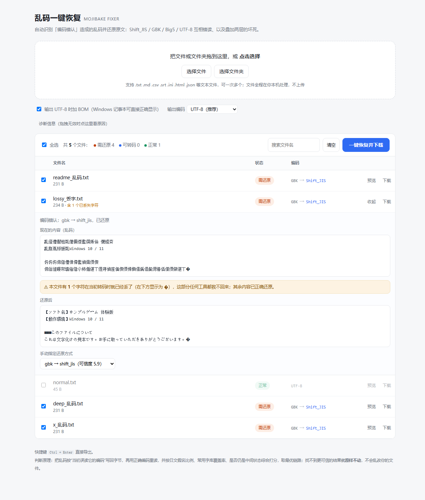

# 乱码一键恢复 · Mojibake Fixer

> 把「打开就全是乱码」的日文/中文文本文件，一键还原成正确的 UTF-8。
> 单文件、纯前端、零依赖、完全离线——文件不会离开你的电脑。

```
现在看到：亂僜僼僩柤亃僒儞僾儖僎乕儉 懱尡斉
本来内容：【ソフト名】サンプルゲーム 体験版
```



## 快速开始

1. 下载 [`dist/mojibake-fixer.html`](dist/mojibake-fixer.html)
2. 双击用浏览器打开（Edge / Chrome / Firefox 均可）
3. 把文件或文件夹拖进页面 → 勾选 → 「一键恢复并下载」

不需要安装、不需要联网、不需要 Node。多个文件会自动打包成 ZIP（中文文件名正常）。

## 它解决的是哪几种乱码

关键前提：**「乱码」有两种，处理方式完全不同。**

| 类型 | 实际发生了什么 | 例子 | 工具怎么处理 |
|---|---|---|---|
| **显示型** | 文件本身没错，是打开它的程序猜错编码 | 一份正常的 UTF-8 日文，被记事本按 GBK 打开 | 探测真实编码，转存为 UTF-8（可加 BOM），Windows 记事本从此认对 |
| **内容型** | 已经被「误读后又另存」，字节真的变了 | 日文文件被以 GBK 读取后另存为 UTF-8 | 按当初误读它的编码把字节写回，再用正确编码重读 |
| **双层坏死** | 上面的事发生了两次 | SJIS → 被当 GBK 读 → 又被当 GBK 读 | 深度 2 穷举整条链路，逐层剥离 |

常见来路：Shift_JIS / GBK / Big5 / EUC-JP / Windows-1252 / UTF-8 之间的互相错读。

## 判定原理

不做「猜一个国家语言」这种事，做的是**链路枚举 + 可信度打分**：

1. **枚举**：把文本按每种「可能被误读成的编码」写回字节，再用每种「可能的真实编码」重读，得到一批候选（含两步链路，共约 900 条）。
2. **打分**：
   - **假名比例**——真日文几乎必有平假名，乱码垃圾基本没有，权重最高
   - **常用字覆盖率**——用 GB2312 一级汉字（3755 字）+ JIS X 0208 第一水准汉字（2965 字）现场生成常用字集，乱码产生的汉字大多落在外面
   - **中间态检验**——候选结果如果「再剥一层又变成合法 UTF-8」，说明还没剥到底，重罚
   - 半角片假名、C0/C1 控制符、私用区字符、U+FFFD 一律重罚
   - 链路每多一步扣分（优先解释更简单的假设）
3. **一票否决**：找不到比原文显著更可信的结果，就**原样不动**。宁可不修，绝不改坏。

这些「常用字集」不是打包进仓库的词表，而是启动时从浏览器的解码器现场枚举出来的（见 `src/engine.js` 的 `getCommon()`），所以整个应用没有任何数据文件依赖。

## 已知限制

- **已丢字不可逆**：误读时被 `?` 或 `�` 替换掉的字节，任何工具都救不回来；这些字符会原样保留并计入扣分。界面会明确标出：「还原后」上方提示**本文件有 N 个字符在当初转码时已丢失**，列表里也显示「含 N 个已丢失字符」。
  这样就能区分两件常常被混淆的事：**显示层缺字体（画成豆腐块 □，信息其实完好）** 与 **真丢字（`�`，信息确实没了）**——判断标准是复制出来是不是真字。
- 不做 GB18030 的四字节区（极生僻字），也不做简繁互转。
- 单个文件上限 20 MB；二进制文件自动跳过。
- **拖文件夹**依赖浏览器的目录读取能力：网络盘、压缩包内部、OneDrive 云端占位文件常常读不出来。这种情况页面会提示改用「选择文件夹」，并可在「诊断信息」里看到卡在哪一层。

## 开发

```
src/engine.js            还原引擎（编码表、打分、链路搜索）——零依赖，可单独复用
src/app.js               界面逻辑（拖拽、列表、导出）
src/zip.js               极简 ZIP 打包（仅存储，无压缩，无第三方库）
src/app.template.html    模板与样式
build.mjs                把上面四个拼成单文件 dist/mojibake-fixer.html

tests/engine.test.mjs    引擎回归测试（19 个用例，含「必须不改动」的反向用例）
tests/browser/*.mjs      浏览器端验证：用 CDP 真实注入文件拖拽事件 / mock 目录条目
```

```bash
node tests/engine.test.mjs   # 跑回归测试
node build.mjs               # 重新生成 dist/mojibake-fixer.html
```

浏览器侧测试需要本机装有 Edge 或 Chrome，脚本会自动探测路径，也可用 `EDGE_PATH` 环境变量指定。

## 许可

MIT · Author: **Gurimu**（グリム）
